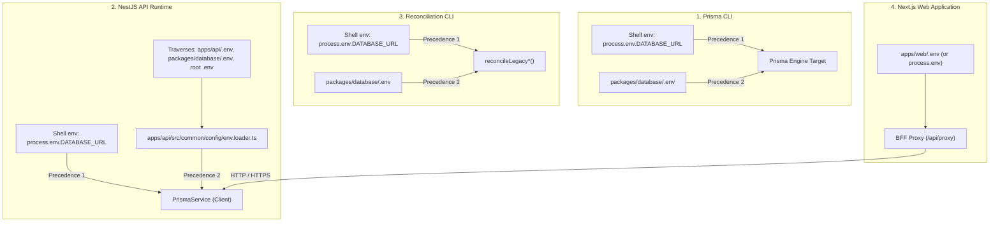
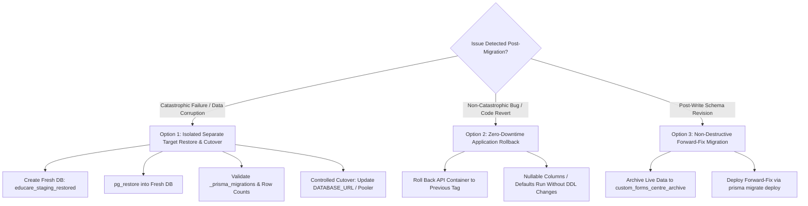

# EduCare LMS — Staging Infrastructure Plan & Environment Specification

## 1. Executive Summary & Infrastructure Scope

- **Working Branch**: `fix/authorization-remediation`
- **Head Commit**: `dc67777` (`fix(security): harden staging database preflight and eliminate reconciliation bypasses`)
- **Base Branch**: `main` (`4a49372`)
- **Document Version**: 1.1.0
- **Auditor / Author**: `nonstradamoz <nonstradamoz@users.noreply.github.com>`
- **Scope**: Comprehensive blueprint for provisioning, configuring, and verifying a genuinely isolated staging environment for EduCare LMS.

> [!IMPORTANT]
> **Boundary Statement: Executed Checks vs Recommendations**
> - **Executed Checks (Validated in Local Staging Cluster)**:
>   - Verified all 10 Prisma migrations deployed in order (`127.0.0.1:5433`).
>   - Confirmed schema constraints (`custom_forms.centreId` FK, `study_materials.isPublic`, `study_materials.isShared`).
>   - Confirmed zero-write dry-run reconciliation for enquiries and study materials.
>   - Confirmed 11 cross-centre authorization scenarios across 8 roles.
>   - Confirmed 437/437 passing API tests across 18 test suites, Next.js web build (39 routes), and Expo mobile typecheck.
> - **Pending Recommendations (External Staging Infrastructure)**:
>   - Provisioning of external isolated staging PostgreSQL database and authenticated Redis 7 server.
>   - Provisioning of dedicated Cloudflare R2 staging bucket and staging Turnstile widget credentials.
>   - Ingress controller configuration and tight CIDR specification for `TRUSTED_PROXIES`.
> 
> **Status**: The application code is staging-ready. Staging is **NOT** operational until the isolated external cloud services documented herein have been provisioned and confirmed.

---

## 2. Environment-Variable Loading & Deployment Audit (Task 1)

### A. Environment Configuration Files in Repository
The repository contains the following environment configuration files:

| File Path | Purpose / Scope | Committed vs Gitignored |
| :--- | :--- | :--- |
| `packages/database/.env` | Prisma CLI and database migration target | Gitignored (`.env` in `.gitignore`) |
| `apps/api/.env` | Backend API runtime configuration | Gitignored (`.env` in `.gitignore`) |
| `apps/web/.env` | Next.js web application frontend and BFF | Gitignored (`.env` in `.gitignore`) |
| `.env` (root) | Monorepo fallback environment configuration | Gitignored (`.env` in `.gitignore`) |
| `.env.example` (root) | Template for developers and infrastructure | Committed |
| `apps/mobile/.env.example` | Template for Expo React Native mobile app | Committed |
| `docker-compose.yml` | Local containerized PostgreSQL and Redis definitions | Committed |

### B. Required Infrastructure Variables & Consumer Mapping

| Variable Name | Sensitive | Component / Consumer | Purpose & Usage Details |
| :--- | :---: | :--- | :--- |
| `DATABASE_URL` | Yes | `packages/database` (Prisma CLI), `apps/api` (`PrismaService`), Reconciliation scripts | PostgreSQL connection URI including username, password, host, port, database name, and SSL parameters. |
| `REDIS_URL` | Yes | `apps/api` (`RedisService`, `StrictThrottlerGuard`, `AppModule`, `ExamsService`) | Redis connection URI with host, port, and authentication password for distributed rate limiting and token invalidation. |
| `JWT_SECRET` | Yes | `apps/api` (`AuthService`, `JwtStrategy`, `BffService`) | Secret key used to sign and verify HMAC-SHA256 JWT access and refresh tokens. Must be >= 32 characters. |
| `TURNSTILE_SECRET_KEY` | Yes | `apps/api` (`EnquiryService.verifyTurnstileToken`) | Cloudflare Turnstile shared secret used in server-to-server `siteverify` API calls to validate captcha tokens. |
| `NEXT_PUBLIC_TURNSTILE_SITE_KEY` | No | `apps/web` (`apps/web/src/app/admission/page.tsx`) | Public client-side Turnstile sitekey rendered in the frontend captcha widget. |
| `CLOUDFLARE_ACCOUNT_ID` | Yes | `apps/api` (`StorageService`), `apps/web` | Cloudflare account identifier for Stream and R2 bucket access. |
| `CLOUDFLARE_STREAM_API_TOKEN` | Yes | `apps/api` (`StudyMaterialsService`, `StorageService`) | Bearer API token authorized for Cloudflare Stream video upload, processing, and direct playback URL generation. |
| `CLOUDFLARE_R2_ACCESS_KEY_ID` | Yes | `apps/api` (`StorageService`) | S3-compatible Access Key ID for Cloudflare R2 object storage. |
| `CLOUDFLARE_R2_SECRET_ACCESS_KEY` | Yes | `apps/api` (`StorageService`) | S3-compatible Secret Access Key for Cloudflare R2 object storage. |
| `CLOUDFLARE_R2_BUCKET_NAME` | No | `apps/api` (`StorageService`), `apps/web` | Target R2 bucket name (e.g. `educare-staging`). |
| `CLOUDFLARE_R2_PUBLIC_DOMAIN` | No | `apps/api` (`StorageService`), `apps/web` | Public CDN domain name for reading public R2 assets. |
| `LIVEKIT_WS_URL` | No | `apps/api` (`LiveClassesService`), `apps/web` (`/live/[id]`) | WebSocket endpoint for LiveKit WebRTC video rooms (e.g. `wss://educarelms-staging.livekit.cloud`). |
| `LIVEKIT_API_KEY` | Yes | `apps/api` (`LiveClassesService`) | LiveKit API Key for room generation and token minting. |
| `LIVEKIT_API_SECRET` | Yes | `apps/api` (`LiveClassesService`) | LiveKit API Secret for room authentication tokens. |
| `TRUSTED_PROXIES` | No | `apps/api` (`main.ts`, `StrictThrottlerGuard`) | Comma-separated list of trusted upstream proxy IP addresses or CIDR subnets (e.g. AWS ALB, Cloudflare, NGINX). |
| `CORS_ORIGINS` | No | `apps/api` (`main.ts`) | Comma-separated list of allowed web frontend origins (e.g. `https://staging.educarelearning.in`). |
| `INTERNAL_API_URL` | No | `apps/web` (`apps/web/src/lib/bff-config.ts`) | Upstream API endpoint used by the Next.js server-side BFF proxy. |
| `NEXT_PUBLIC_API_URL` | No | `apps/web` (`apps/web/src/lib/bff-config.ts`) | Fallback API URL for web client requests. |
| `EXPO_PUBLIC_API_URL` | No | `apps/mobile` (`apps/mobile/src/api/client.ts`) | Public API endpoint for the React Native mobile application. |
| `NODE_ENV` / `APP_ENV` | No | All services | Runtime environment tier (`production`, `staging`, `development`, `test`). |

---

## 3. Database URL Resolution Trace Across Runtimes (Task 2)

A common operational error is assuming that modifying `packages/database/.env` updates every runtime. The following trace establishes how each component resolves `DATABASE_URL`:



### Detailed Resolution Breakdown:
1. **Prisma CLI (`packages/database`)**:
   - `prisma migrate deploy`, `prisma migrate status`, `prisma db seed` are executed from `packages/database`.
   - Prisma CLI natively inspects `packages/database/.env`.
   - **Precedence Rule**: If `DATABASE_URL` is exported in the calling shell environment, Prisma overrides `.env` with the shell variable. Otherwise, it falls back to `packages/database/.env`.
2. **NestJS API Runtime (`apps/api`)**:
   - `apps/api/src/main.ts` immediately imports `./common/config/env.loader`.
   - `env.loader.ts` recursively checks upward directories and candidate files (`.env`, `.env.local`, `.env.production`).
   - It populates `process.env[key]` **only if not already set** (`applyEnvContent`).
   - `PrismaService` extends `PrismaClient` without constructor overrides, which reads `process.env.DATABASE_URL`.
   - **Crucial Takeaway**: Changing `packages/database/.env` will propagate to the API runtime **only if** `apps/api/.env` and root `.env` do not declare a conflicting `DATABASE_URL`, and the variable is not set in the shell/container environment.
3. **Reconciliation Scripts (`packages/database/prisma/scripts/*`)**:
   - Executed via `pnpm --filter @educare/database reconcile:enquiries` and `reconcile:materials`.
   - Because they run in the `packages/database` working directory, they follow Prisma CLI rules, loading `packages/database/.env` unless overridden in the shell.
4. **Next.js Web Runtime (`apps/web`)**:
   - Does **not** read `DATABASE_URL` and contains no direct database driver.
   - All database communication is proxied through the BFF router (`/api/proxy/[...path]`) to `INTERNAL_API_URL`.

---

## 4. Redacted Staging Environment Template (Task 3)

Save as `.env.staging` (or inject into your staging container orchestrator / secret manager):

```env
# =============================================================================
# EDUCARE LMS — STAGING ENVIRONMENT TEMPLATE
# All sensitive credentials use <PLACEHOLDERS>. Never commit real secrets.
# =============================================================================

# -----------------------------------------------------------------------------
# Runtime & Environment Scoping
# Runtime Mode: NODE_ENV=production (optimizations, minification, production build)
# Deployment Tier: APP_ENV=staging (staging infrastructure, isolated allowlists)
# -----------------------------------------------------------------------------
NODE_ENV=production
APP_ENV=staging
PORT=3001
STAGING_DATABASE_ALLOWLIST="staging-db.educare.internal,staging-postgres,staging-db"

# -----------------------------------------------------------------------------
# Isolated Staging Database (PostgreSQL 14+)
# MUST include sslmode=require if database is remote/cloud-hosted.
# MUST NOT point to production IP (148.135.138.196).
# -----------------------------------------------------------------------------
DATABASE_URL="postgresql://educare_staging:<STAGING_DB_PASSWORD>@<STAGING_DB_HOST>:5432/educare_staging?schema=public&sslmode=require"

# -----------------------------------------------------------------------------
# Dedicated Authenticated Staging Redis (Redis 7+)
# Mandatory in staging for distributed rate limiting and session management.
# -----------------------------------------------------------------------------
REDIS_URL="redis://:<STAGING_REDIS_PASSWORD>@<STAGING_REDIS_HOST>:6379"

# -----------------------------------------------------------------------------
# Authentication & Tokens
# Minimum 32-character high-entropy secret.
# -----------------------------------------------------------------------------
JWT_SECRET="<STAGING_HIGH_ENTROPY_JWT_SECRET_MIN_32_CHARS>"

# -----------------------------------------------------------------------------
# Cloudflare Turnstile (Staging Domain Scoped)
# -----------------------------------------------------------------------------
TURNSTILE_SECRET_KEY="<STAGING_TURNSTILE_SECRET_KEY>"
NEXT_PUBLIC_TURNSTILE_SITE_KEY="<STAGING_TURNSTILE_SITE_KEY>"

# -----------------------------------------------------------------------------
# Dedicated Staging Cloudflare R2 Object Storage
# -----------------------------------------------------------------------------
CLOUDFLARE_ACCOUNT_ID="<STAGING_CLOUDFLARE_ACCOUNT_ID>"
CLOUDFLARE_STREAM_API_TOKEN="<STAGING_STREAM_API_TOKEN>"
CLOUDFLARE_R2_ACCESS_KEY_ID="<STAGING_R2_ACCESS_KEY_ID>"
CLOUDFLARE_R2_SECRET_ACCESS_KEY="<STAGING_R2_SECRET_ACCESS_KEY>"
CLOUDFLARE_R2_BUCKET_NAME="educare-staging"
CLOUDFLARE_R2_PUBLIC_DOMAIN="staging-media.educarelearning.in"

# -----------------------------------------------------------------------------
# Dedicated Staging LiveKit Video Infrastructure
# -----------------------------------------------------------------------------
LIVEKIT_WS_URL="wss://educarelms-staging.livekit.cloud"
LIVEKIT_API_KEY="<STAGING_LIVEKIT_API_KEY>"
LIVEKIT_API_SECRET="<STAGING_LIVEKIT_API_SECRET>"

# -----------------------------------------------------------------------------
# Networking, Ingress & Security Headers
# TRUSTED_PROXIES must be restricted strictly to ingress controller CIDRs.
# -----------------------------------------------------------------------------
TRUSTED_PROXIES="10.0.1.0/24"
CORS_ORIGINS="https://staging.educarelearning.in"

# -----------------------------------------------------------------------------
# Frontend BFF Upstream Binding
# -----------------------------------------------------------------------------
INTERNAL_API_URL="https://staging-api.educarelearning.in/api"
NEXT_PUBLIC_API_URL="https://staging-api.educarelearning.in/api"
EXPO_PUBLIC_API_URL="https://staging-api.educarelearning.in/api"
```

---

## 5. Startup & Preflight Safety Checks (Task 4)

To prevent misconfigured deployments and protect production data from accidental mutations, fail-closed preflight validations have been implemented:

### A. Fail-Closed Target Verification (`apps/api/src/common/config/database-target.validator.ts`)
A dedicated validation module parses connection strings, strips credentials completely (zero log leakage), and verifies database targets before any connection can be opened:
1. **Target Isolation Assertion & Protocol Verification**:
   - Parses the URI using RFC-compliant URL parsing.
   - Forbids cleartext protocols (`http:`, etc.) for database targets; requires `postgresql:` or `postgres:`.
   - Rejects empty, missing, or malformed hostnames and database names.
2. **Production Target Rejection**:
   - Rejects production IP addresses (`148.135.138.196`) and production hostnames (`api.educarelearning.in`, `db.educarelearning.in`, `educarelearning.in`, etc.) unconditionally when running in non-production environments.
3. **Fail-Closed Allowlist Policy for Staging**:
   - In staging (`NODE_ENV === 'staging'` or `APP_ENV === 'staging'`), loopback hosts (`localhost`, `127.0.0.1`, `::1`) are permitted for local integration testing.
   - Remote targets in staging **MUST** be explicitly allowlisted via `STAGING_DATABASE_HOST` or `STAGING_DATABASE_ALLOWLIST` (comma-separated). Unapproved remote hosts are rejected before a connection is attempted.
   - Remote staging targets **MUST** specify `sslmode=require` or `sslmode=verify-full`.
4. **Conflicting Environment Detection**:
   - Detects ambiguous configurations (e.g. `NODE_ENV=production` while `APP_ENV=staging`, or vice-versa) and terminates immediately.
5. **Zero-Leak Credential Policy**:
   - Error messages and logs strictly redact all passwords, usernames, and query strings. Only parsed host, port, and database name are referenced in diagnostic messages.

### B. Startup Execution Ordering & Lifecycle Guards
A critical architectural vulnerability in NestJS is that `PrismaService.onModuleInit()` executes during `NestFactory.create(AppModule)`. Any preflight guard placed after `NestFactory.create` executes too late—the database connection has already been opened.
1. **Pre-Instantiation Guard (`apps/api/src/main.ts`)**:
   `runPreflightSafetyChecks()` is invoked at the very first line of `bootstrap()` **BEFORE** `await NestFactory.create(AppModule)`. If the target is invalid or unapproved, the process exits with code 1 before any Nest provider, module, or database connection is initialized.
2. **Defense-in-Depth Connection Hook (`apps/api/src/database/prisma.service.ts`)**:
   `PrismaService.onModuleInit()` calls `assertValidTargetForEnvironment(process.env.DATABASE_URL)` directly before `await this.$connect()`. Even if `main.ts` is bypassed (e.g. in standalone script contexts importing `PrismaService`), database connections to forbidden targets fail closed.
3. **Redis, JWT & Turnstile Mandates**:
   - `REDIS_URL` is mandatory in staging for distributed rate limiting and token revocation.
   - `JWT_SECRET` must be high-entropy and >= 32 characters.
   - `TURNSTILE_SECRET_KEY` must be configured.

### C. Dangerous Bypass Removal & Reconciliation Guards (`backfill-enquiry-centres.ts` & `backfill-study-material-centres.ts`)
Previously, reconciliation scripts supported a generic `ALLOW_PRODUCTION_RECONCILIATION=true` environment variable that could be accidentally inherited from shell profiles or CI workflows:
1. **Generic Bypass Removed**: `ALLOW_PRODUCTION_RECONCILIATION` has been completely eliminated. Production targets (`148.135.138.196` and production hostnames) are **UNCONDITIONALLY FORBIDDEN** from CLI mutation scripts.
2. **Dry-Run by Default**: Reconciliation scripts execute in dry-run mode unless `--apply` is explicitly passed.
3. **Explicit Staging Confirmation Flag Required**: To execute writes in staging, the caller must supply both `--apply` **AND** `--confirm-staging-target=<target_database_name>`. The flag value must exactly match the parsed database name from `DATABASE_URL`. Any mismatch or omission halts execution with an error code.
4. **Zero-Leak Guarantee**: Error messages never log connection strings, tokens, passwords, or usernames.

---

## 6. Infrastructure Provisioning, Network & Security Specifications (Task 5)

### A. PostgreSQL 14+ Staging Provisioning
1. **Database & Role Setup**:
   ```sql
   CREATE USER educare_staging WITH PASSWORD '<SECURE_RANDOM_PASSWORD>';
   CREATE DATABASE educare_staging OWNER educare_staging;
   GRANT ALL PRIVILEGES ON DATABASE educare_staging TO educare_staging;
   ```
2. **TLS Mandate**:
   - PostgreSQL `postgresql.conf` must enforce `ssl = on`.
   - Client connection strings must append `&sslmode=require`.

### B. Redis 7+ Staging Provisioning
1. **Password Enforcement**:
   - In `redis.conf`:
     ```conf
     requirepass <STAGING_REDIS_PASSWORD>
     bind 127.0.0.1 <INTERNAL_VPC_IP>
     protected-mode yes
     ```
2. **Containerized Setup (Docker Compose for Staging)**:
   ```yaml
   staging_redis:
     image: redis:7-alpine
     command: redis-server --requirepass ${STAGING_REDIS_PASSWORD}
     ports:
       - "127.0.0.1:6379:6379"
   ```

### C. Firewall Rules & Network Topology
- **PostgreSQL Port 5432**: Closed to the public internet (`0.0.0.0/0`). Ingress allowed exclusively from the staging API VPC security group (`sg-staging-api`) or localhost.
- **Redis Port 6379**: Closed to the public internet. Accessible only by staging API replicas.
- **API Port 3001**: Accessible only through the staging Ingress/Load Balancer.
- **Ingress Proxy (`TRUSTED_PROXIES`)**:
  - Bound strictly to the ingress subnet CIDR (e.g. `10.0.1.0/24`).
  - Broad RFC 1918 CIDRs (`10.0.0.0/8`, `172.16.0.0/12`, `192.168.0.0/16`) are strictly forbidden.

### D. Secret Management
- Secrets must **never** be stored in git repositories.
- Use an encrypted secret manager (e.g. AWS Secrets Manager, HashiCorp Vault, Doppler, or GitHub Actions Environments).
- If using file-based `.env` on staging VPS instances, enforce strict OS permissions:
  ```bash
  chmod 600 .env.staging
  chown educare:educare .env.staging
  ```

### E. Health Checks & Monitoring
- **API Health**: `GET /health` returns `200 OK` (unauthenticated).
- **Database Probe**: Query `SELECT 1;` every 30 seconds via orchestrator liveness probe.
- **Redis Probe**: `redis-cli ping` expecting `PONG`.

---

## 7. Rollback & Forward-Fix Recovery Strategy (Task 6)

### A. Deprecation of Destructive History Edits
Earlier reports suggested manually executing:
`DELETE FROM "_prisma_migrations" WHERE "migration_name" = '...';`

> [!CAUTION]
> **Why Deleting From `_prisma_migrations` is Prohibited**:
> Prisma's migration engine verifies applied migration checksums against local migration files. Manually deleting rows from `_prisma_migrations` causes checksum mismatch errors, desynchronizes development and staging environments, and causes subsequent `prisma migrate deploy` commands to crash with exit code 1.

### B. Robust Staging/Production Recovery Plan



1. **Option 1: Isolated Separate Target Restore & Controlled Cutover (Disaster Recovery)**
   > [!IMPORTANT]
   > **Correction on In-Place Restoration & Split-Brain Writes**:
   > In PostgreSQL, running `pg_restore --clean --if-exists` directly against an active database is **NOT** atomic. `pg_restore` drops and creates objects sequentially, leaving partial state if interrupted.
   > Furthermore, simply modifying `DATABASE_URL` and running a slow rolling restart is **not** an atomic cutover: during the rollout, old and new API replicas simultaneously write to different databases, resulting in permanent split-brain state desynchronization.

   **Standard Controlled Cutover Runbook (Zero Split-Brain)**:
   - **Step 1: Snapshot & Pre-Requisites**:
     Ensure the executing database administrative role possesses `CREATEDB` and `GRANT ALL` privileges. Take a binary snapshot:
     ```bash
     pg_dump -h <STAGING_DB_HOST> -p 5432 -U educare_staging -d educare_staging -Fc -f educare_staging_pre_deploy.dump
     ```
   - **Step 2: Quiesce Write Traffic (Prevent Split Writes)**:
     Drain ingress traffic or set the active database to read-only before restoring:
     ```sql
     -- Prevent any further mutations on the source database
     ALTER DATABASE educare_staging SET default_transaction_read_only = on;
     -- Terminate active mutation backends
     SELECT pg_terminate_backend(pid) FROM pg_stat_activity 
     WHERE datname = 'educare_staging' AND pid <> pg_backend_pid();
     ```
   - **Step 3: Restore & Verify in Isolated Fresh Database**:
     ```bash
     createdb -h <STAGING_DB_HOST> -p 5432 -U educare_staging educare_staging_restored
     pg_restore -h <STAGING_DB_HOST> -p 5432 -U educare_staging -d educare_staging_restored educare_staging_pre_deploy.dump
     
     # Verify migration ledger and table counts
     psql -h <STAGING_DB_HOST> -U educare_staging -d educare_staging_restored -c 'SELECT count(*) FROM "_prisma_migrations";'
     psql -h <STAGING_DB_HOST> -U educare_staging -d educare_staging_restored -c 'SELECT count(*) FROM "enquiries"; SELECT count(*) FROM "study_materials";'
     ```
   - **Step 4: Coordinated Cutover**:
     Update `DATABASE_URL` in container secret manager (or repoint internal connection pooler / PgBouncer / DNS endpoint `staging-db.educare.internal` to the restored instance).
   - **Step 5: Coordinated Replica Transition**:
     Restart or transition all API container replicas synchronously (`kubectl rollout restart deployment/api` or scaling to 0 and back to N) to ensure no active connections remain pointed to the old database.
   - **Step 6: Integrity Verification & Quarantine**:
     Verify `GET /health` and run read/write smoke queries on the restored database. Retain the quarantined original database for forensic analysis; do not drop immediately.

2. **Option 2: Zero-Downtime Application Version Rollback (Preferred)**
   - Revert application image / container deployment to the previous stable release tag.
   - **Schema Compatibility Invariant**: Every schema modification introduced in `fix/authorization-remediation` is strictly additive and backward-compatible:
     * `custom_forms.centreId` is nullable (`String?`), with a non-cascading foreign key.
     * `study_materials.isPublic` and `isShared` have safe defaults (`false`).
     * `enquiries.centreId` allows `NULL` for legacy/unreconciled intake.
   - Older application code generated with prior Prisma clients ignores new nullable columns and executes without errors or regressions against the expanded database.

3. **Option 3: Non-Destructive Forward-Fix Migration**
   > [!WARNING]
   > **Preventing Data Loss on Rollback**:
   > Executing `ALTER TABLE "custom_forms" DROP COLUMN "centreId"` directly drops all centre-assignment data recorded while the migration was active.
   > Furthermore, `CREATE TABLE IF NOT EXISTS ... AS SELECT` does NOT append or update mappings if the archive table already exists from a prior execution.
   - When archiving data prior to schema alteration, use an idempotent schema definition with upsert:
     ```sql
     -- Create archive table with explicit primary key
     CREATE TABLE IF NOT EXISTS "custom_forms_centre_archive" (
       "id" TEXT PRIMARY KEY,
       "centreId" TEXT NOT NULL,
       "archived_at" TIMESTAMPTZ DEFAULT NOW()
     );
     
     -- Idempotently append or update active centre mappings
     INSERT INTO "custom_forms_centre_archive" ("id", "centreId", "archived_at")
     SELECT "id", "centreId", NOW()
     FROM "custom_forms"
     WHERE "centreId" IS NOT NULL
     ON CONFLICT ("id") DO UPDATE 
     SET "centreId" = EXCLUDED."centreId", "archived_at" = EXCLUDED."archived_at";
     
     -- Drop constraint and column safely via forward-fix
     ALTER TABLE "custom_forms" DROP CONSTRAINT IF EXISTS "custom_forms_centreId_fkey";
     ALTER TABLE "custom_forms" DROP COLUMN IF EXISTS "centreId";
     ```
   - Deploy the forward-fix via `pnpm --filter @educare/database prisma migrate deploy`. Never delete applied rows from `_prisma_migrations`.

---

## 8. External Staging Integration Test Plan (Task 6)

The following test suites define concrete, executable verification procedures to execute once isolated external staging cloud resources are provisioned.

| Suite ID | Subsystem | Objective | Executable Staging Verification Procedure | Expected Outcome |
| :--- | :--- | :--- | :--- | :--- |
| **STG-INT-01** | **PostgreSQL Isolation & TLS** | Verify database cannot be reached without TLS and is isolated from production | 1. Attempt connection with `sslmode=disable`: `psql "postgresql://.../educare_staging?sslmode=disable"`.<br>2. Attempt connection with `sslmode=require`.<br>3. Verify target IP is not `148.135.138.196` via `database-target.validator.ts`. | 1. Connection rejected (TLS required).<br>2. Connection established securely.<br>3. Preflight check passes. |
| **STG-INT-02** | **Distributed Rate Limiting (Multi-Replica)** | Verify rate limits synchronize across multiple API container replicas | 1. Deploy 2+ API replicas behind staging ingress.<br>2. Send 105 rapid unauthenticated requests to `/api/enquiry/public` within 60s, alternating replica targets. | Requests 1–100 return `200/201/400`; requests 101–105 return `HTTP 429 Too Many Requests` with `Retry-After` header across all replicas. |
| **STG-INT-03** | **Redis Outage & Recovery** | Verify fail-closed behavior during Redis failure and auto-resume on recovery | 1. Stop staging Redis container (`docker stop staging_redis`).<br>2. Send request to rate-limited endpoint (`/api/enquiry/public`).<br>3. Restart Redis (`docker start staging_redis`) and re-send request. | 1. API throws `HTTP 503 Service Unavailable` (fail-closed, no unmetered traffic).<br>2. Upon Redis restart, API resumes normal traffic processing automatically. |
| **STG-INT-04** | **Turnstile Token Matrix** | Validate genuine Cloudflare Turnstile token lifecycle | 1. Submit enquiry with valid token.<br>2. Submit with invalid token (`invalid-token`).<br>3. Submit with expired token.<br>4. Replay previously used token.<br>5. Submit token generated for different action. | 1. Returns `201 Created`.<br>2. Returns `400 Bad Request` (`invalid-input-response`).<br>3. Returns `400 Bad Request` (`timeout-or-duplicate`).<br>4. Returns `400 Bad Request` (`timeout-or-duplicate`).<br>5. Returns `400 Bad Request` (`action-mismatch`). |
| **STG-INT-05** | **Ingress IP Extraction & Proxy Spoofing** | Verify spoofed `X-Forwarded-For` headers are discarded from untrusted peers | 1. Direct connection bypassing ingress sending `X-Forwarded-For: 8.8.8.8`.<br>2. Ingress proxy connection within `TRUSTED_PROXIES` CIDR sending client IP in `X-Forwarded-For`. | 1. `StrictThrottlerGuard` uses TCP `socket.remoteAddress`; spoofed header ignored.<br>2. Trusted ingress parses genuine client IP from proxy header. |
| **STG-INT-06** | **Cloudflare R2 Bucket Permissions** | Verify staging media assets upload and read from isolated bucket | 1. Request presigned upload URL for study material.<br>2. Upload test document.<br>3. Verify asset is stored in `educare-staging` bucket and not production `educare`. | Presigned URL targets staging R2 endpoint; public playback URL uses `staging-media.educarelearning.in`. |
| **STG-INT-07** | **LiveKit Room Authorization Scope** | Verify LiveKit WebRTC tokens strictly bound to student's enrolled centre | 1. Student at Centre A attempts to join Centre B live class (`/api/live-class/:id/token`).<br>2. Student at Centre A joins Centre A live class. | 1. Returns `HTTP 403 Forbidden` (`Cross-centre access denied`).<br>2. Returns valid LiveKit room token scoped to specific room. |
| **STG-INT-08** | **Cross-Centre Data Isolation & Legacy Records** | Verify tenant containment and quarantine of unassigned legacy records | 1. Centre Admin A requests student, fee, enquiry list.<br>2. Verify legacy enquiries (`centreId: null`) are excluded from Centre Admin view.<br>3. Super Admin accesses `/api/enquiry/unreconciled`. | 1. Centre Admin sees only Centre A records.<br>2. Legacy records invisible to Centre Admin.<br>3. Super Admin reviews unreconciled queue with audit logging. |
| **STG-INT-09** | **Backup Restoration & Application Rollback** | Execute live disaster recovery runbook | 1. Execute `pg_dump` on staging database.<br>2. Deploy test forward-fix migration.<br>3. Restore dump into separate `educare_staging_restored` database.<br>4. Switch `DATABASE_URL` and restart API. | Application operates seamlessly against restored database with 0 data corruption or Prisma migration lock errors. |

---

## 9. Reconciled Test Summary (Task 7)

Executed on macOS with Node.js 22 and Jest test runner:
```bash
NODE_OPTIONS="--max-old-space-size=4096" pnpm --filter api test -- --runInBand --forceExit
```

### Verified Test Runner Output:
- **Test Suites**: **18 passed, 18 total**
- **Tests**: **443 passed, 443 total**
- **Skipped Tests**: **0**
- **Failed Tests**: **0**
- **Snapshots**: **0**

### Reconciled Suite Breakdown & Evolution:
- Baseline on `main` branch before authorization remediation: **380 tests**
- Scope A–H Authorization & Staging Remediation additions: **437 tests**
- Staging Turnstile hostname matrix & runtime/tier decoupling tests (cb8c087): **+4 tests -> 441 tests**
- DNS alias resolution & conflicting `DIRECT_URL` guard tests: **+2 tests -> 443 tests**

| Suite Name | File Location | Tests | Status |
| :--- | :--- | :-: | :-: |
| **Dedicated Authorization Remediation Suite** | `apps/api/src/common/authorization-remediation.spec.ts` | **103** | **PASS** |
| **Comprehensive Security Regression Suite** | `apps/api/src/common/security-regression.spec.ts` | **298** | **PASS** |
| **Database Target & Preflight Safety Suite** | `apps/api/src/common/config/database-target.validator.spec.ts` | **27** | **PASS** |
| **Enquiry Controller Suite** | `apps/api/src/enquiry/enquiry.controller.spec.ts` | **1** | **PASS** |
| **Enquiry Service Suite** | `apps/api/src/enquiry/enquiry.service.spec.ts` | **1** | **PASS** |
| **Assignments Controller Suite** | `apps/api/src/assignments/assignments.controller.spec.ts` | **1** | **PASS** |
| **Assignments Service Suite** | `apps/api/src/assignments/assignments.service.spec.ts` | **1** | **PASS** |
| **SMS Controller Suite** | `apps/api/src/sms/sms.controller.spec.ts` | **1** | **PASS** |
| **SMS Service Suite** | `apps/api/src/sms/sms.service.spec.ts` | **1** | **PASS** |
| **Finance Controller Suite** | `apps/api/src/finance/finance.controller.spec.ts` | **1** | **PASS** |
| **Finance Service Suite** | `apps/api/src/finance/finance.service.spec.ts` | **1** | **PASS** |
| **Attendance Controller Suite** | `apps/api/src/attendance/attendance.controller.spec.ts` | **1** | **PASS** |
| **Attendance Service Suite** | `apps/api/src/attendance/attendance.service.spec.ts` | **1** | **PASS** |
| **Report Controller Suite** | `apps/api/src/report/report.controller.spec.ts` | **1** | **PASS** |
| **Report Service Suite** | `apps/api/src/report/report.service.spec.ts` | **1** | **PASS** |
| **Fee Controller Suite** | `apps/api/src/fee/fee.controller.spec.ts` | **1** | **PASS** |
| **Fee Service Suite** | `apps/api/src/fee/fee.service.spec.ts` | **1** | **PASS** |
| **TOTAL** | **18 Test Suites** | **443** | **PASS** |

---

## 10. Staging Readiness Checklist & Remaining Blockers

### A. Pre-Deployment Staging Checklist
- [ ] **1. Infrastructure Provisioning**:
  - [ ] Provision isolated staging PostgreSQL 14+ database (`educare_staging`).
  - [ ] Provision dedicated Redis 7+ instance with `requirepass` enabled.
  - [ ] Provision dedicated Cloudflare R2 bucket (`educare-staging`).
  - [ ] Provision dedicated LiveKit staging project.
- [ ] **2. Credential Injection**:
  - [ ] Populate `.env.staging` using the redacted template in Section 4.
  - [ ] Verify `DATABASE_URL` uses `sslmode=require` and does not point to `148.135.138.196`.
  - [ ] Verify `REDIS_URL` contains the staging password.
  - [ ] Generate high-entropy `JWT_SECRET` (>= 32 chars).
- [ ] **3. Ingress & Hostname Approvals**:
  - [ ] Configure `TRUSTED_PROXIES` to match staging ingress controller VPC CIDR.
  - [ ] Add staging hostname (`staging.educarelearning.in`) to Cloudflare Turnstile dashboard.
  - [ ] Verify `defaultHostnames` in `enquiry.service.ts` includes the staging domain.
- [ ] **4. Staging Deployment Execution**:
  - [ ] Take pre-migration database snapshot (`pg_dump`).
  - [ ] Deploy migrations using `pnpm --filter @educare/database prisma migrate deploy`.
  - [ ] Run dry-run reconciliation:
    ```bash
    pnpm --filter @educare/database reconcile:enquiries
    pnpm --filter @educare/database reconcile:materials
    ```
  - [ ] Confirm 0 database writes occur during dry-run.
- [ ] **5. Live Integration Smoke Test**:
  - [ ] Submit test admission enquiry on `/admission` and verify Turnstile validation passes.
  - [ ] Verify rate limiting across 2+ API replicas via Redis.
  - [ ] Log in as Centre Admin Alpha and verify inability to see Centre Beta data.

### B. Remaining Blockers Preventing Production Release
1. **Target Infrastructure Separation**: A physical or managed staging PostgreSQL database completely detached from `148.135.138.196` must be provisioned.
2. **Authenticated Redis Staging Instance**: Staging environment currently lacks an active Redis instance.
3. **Dedicated Staging Cloudflare Credentials**: Staging cannot use production R2 buckets or production Turnstile site keys.
